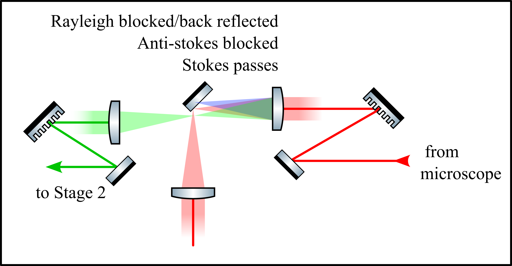
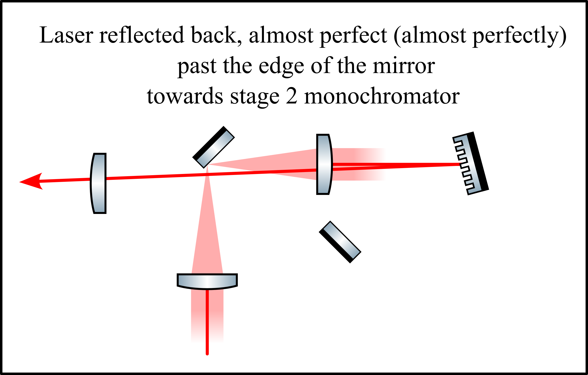
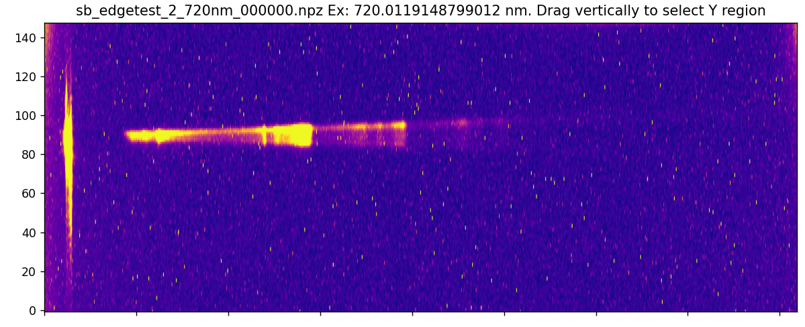

# Stage 1 cutoff edge: why and how to measure it

A bench procedure with its reasoning, for the first measurement towards calibrating the tunable
filter gratings (issue #29). The commands it uses are documented in their docstrings
(`help runfile`, `python -m filter_calibration --help`, and `docs/command_reference.md`); the
run files and the analysis are the `filter_calibration` package.

## 1. Why not jog for intensity

The tunable filter is a double subtractive monochromator: two stages, each a pair of gratings.
Stage 1 is g1/g2 (1200 grooves/mm); stage 2 is g3/g4 (300 grooves/mm). The design is symmetric:
a change at one end is undone by the other end. Changing the angle of g1 changes which
wavelengths focus on which part of the intermediate plane, so the wavelengths that land on the
edge there set the cutoff.

The exit grating then undoes the dispersion and sends a collimated beam onwards. If g1 is
changed by some amount, g2 is changed by an equal amount to restore the output direction. But
that only chooses which chunk of the spectrum passes the edge, and a wide range of spectrum
passes at once: the design is inherently tolerant of angular misalignment. This means:

- **The maximum is a broad plateau.** Its peak is set by noise and does not repeat.
- **The motors are coupled.** The right g2 depends on g1, so tuning one motor means re-tuning
  the other to find a local maximum, over and over, in search of the largest one.
- **Intensity is only half the reference.** The entrance gratings set *where the cutoff is* (a
  wavelength). The exit gratings set *where the beam points* (an angle). Intensity in the
  spectrograph can help with the second, but only with care that each grating is decoupled
  from the others.

So the first step is to define the right reference for each grating:

- **Entrance gratings (g1, g3): the wavelength of the cutoff edge**, read off the CCD, whose
  wavelength axis is now calibrated. This reads a *spectral shape*, so the overall intensity
  does not matter.
- **Exit gratings (g2, g4): beam position, or intensity through a small aperture**, at that
  stage's own exit port. Each stage is aligned to its own entrance and exit ports, and relay
  mirrors carry the axis between stages.

## 2. How stage 1 works, and why its edge is special

The stage 1 edge is the cleaved edge of the 45 degree mirror that brings the laser in. There is
no beamsplitter: the mirror edge sits at the stage's intermediate focus and does two jobs.

**Laser in.** The laser is focused onto the mirror edge and diverges from it to the collimating
lens. The lens collimates it onto g1, which sends it along the microscope's optical axis.


**Scattered light back.** Light scattered from the sample comes back along the same axis. g1
disperses it, and the collimating lens, now working as a focusing lens, spreads the wavelengths
across the plane of the mirror edge:
- Rayleigh and anti-Stokes light focuses onto the mirror and is reflected away.
- Stokes light focuses just past the edge and continues to the next lens and g2.

g2 undoes the dispersion and sends a filtered, collimated beam on to stage 2.



**Why the edge calibration is also the laser calibration.** The laser and the edge are at the
same point, and light retraces its path. So the g1 setting that puts wavelength X on the edge is
also the setting that sends a laser at X down the microscope axis. The edge calibration measured
here therefore doubles as the laser pointing calibration, and the pinhole check becomes a test
of it.

**Alignment mode (the 608 steps).** Step 3 of `docs/grating_alignment_quickstart.md` turns g1 by
about 608 steps. That stops the laser going forwards to the microscope and retroreflects it
almost exactly onto itself, so it lands just past the mirror edge. From there it follows the
path the Stokes light will take: through the next lens and g2, and on to stage 2. That makes
it a visible reference for aligning everything downstream.

In practice the alignment beam is not quite the Stokes beam. The laser, at wavelength X, passes
the edge where Stokes light at X plus a small shift will later pass, so g2 sends it in a
slightly different direction from the Raman light that takes that path. At the end of
alignment, g2 is therefore brought back a few steps. This is usually done while watching
almost no signal, so a strong scatterer such as sulfur or WSe2 helps.

The CCD shows which way to step g2. The periscope between the stages turns stage 1's
dispersion plane vertical, so a pointing error out of stage 1 moves the band along the slit:
one g2 step turns the beam about 0.6 mrad, which is about 3-5 PIXIS rows with the 75-100 mm
lens into the TRIAX. A few steps of error move the band by tens of rows, so read out the full
chip height while correcting g2, and step towards the band's usual row.



*At 1200 grooves/mm, the 10.7 degree rotation (608 steps of about 17.6 mdeg) turns the beam
about 21 degrees, which matches the angle between the two paths.*

## 3. What is measured, and why each detail matters

A broadband (halogen) lamp at the sample position fills the spectrum, and the edge shows on the
CCD as a step in that spectrum. Each frame gives:

- **Edge position.** Fitted with an error function. The edge position against g1 steps is the g1
  calibration.
- **Edge width.** How sharp the cutoff is, in cm^-1, which is what the science needs. The
  collimating lens focuses different wavelengths at slightly different distances (chromatic
  focal shift), so the edge should be sharpest at one wavelength and broaden away from it. The
  measured width against wavelength gives the cost of the lens, and the case for replacing that
  section with curved mirrors.

**What older data already shows.** The frame below is MoS2 at 720 nm excitation through both
stages, on the previous (Tucsen) camera (`docs/demo_data/sb_edgetest_2_720nm_000000.npz`).
Wavelength runs left to right, and the rows run along the slit. The periscope between the
stages swaps the axes, so the rows correspond to stage 1's dispersion plane.



- **The band grows taller with wavelength**, from about 3.7 rows at 727 nm to about 7.3 rows at
  745 nm. That is blur, not dispersion: the rows are a spatial axis.
- **The band's centre moves about 0.16 rows per nm.** A tilt like this is what dispersion left
  over from stage 1 looks like, but a slightly rotated camera gives the same tilt, and this
  frame has no vertical reference to rule that out. (An Ar-Hg frame gives one: its lines should
  be vertical.)
- **The band changes abruptly at 746.3 and 756.3 nm.** Aberrations change smoothly with
  wavelength, so steps this sharp point to something clipping the beam near a focus.

The growth looks vertical-only, but that does not single out astigmatism: the slit clips any
blur across its width, so a round blur also looks vertical on the CCD. An open-slit frame of
discrete lines (an Ar-Hg lamp through the whole chain, or Raman peaks) separates the causes. A
continuum is no use for this, since it smears across the width anyway.
- Round spots that grow with wavelength mean chromatic defocus.
- Spots stretched along one axis, which flip to the other axis as the TRIAX focus moves, mean
  astigmatism.
- Spots cut off on one side mean clipping.

The details of the procedure follow from the two quantities measured, edge position and width:

| Detail | Why |
|---|---|
| Stage 2's intermediate slit removed | Only one edge in the light path, so the step on the CCD is unambiguously stage 1's. With the slit in, its edge hides stage 1's, and the edge on the CCD does not move with g1 (as on 2026-11-17). |
| TRIAX slit wide, about 500 um | The filter stages never cancel the dispersion perfectly, so different wavelengths could reach the TRIAX slit at slightly different places across it, and a narrow slit would then pass only a window of wavelengths whose sides look like an edge. In practice the filtered light reaches the slit as a spot narrower than 200 um. On 2026-11-18 the 200 and 500 um spectra agreed to 1 %, and the edge sat at 803.52, 803.45 and 803.47 nm, 0.76-0.84 nm wide, at 50, 200 and 500 um (lab-notebook RAM-F5). So a wide slit neither moves nor blurs the edge, and the width can be measured at it. A 50 um slit clips the spot: it passed 43 % of the light, a fraction that changed by about 20 % across the chip. |
| Lamp light limited by two aperture cards | Light entering the filter at an angle (in stage 1's dispersion plane) lands on the edge like a different wavelength: about 0.7 nm of edge per mrad. The cards limit that angle. The periscope puts the same angle along the slit, so each CCD row sees one angle: fitted row by row, the edge slants across the rows and each row's width is close to the true width. Summed over the rows, the width is only an upper bound. Step 3 checks the width at operating conditions. |
| Dark and Ar-Hg frames | The dark frame is subtracted. The Ar lines' width is the spectrograph's own line shape, which is removed from the edge width. The Ar-Hg frame is taken at 50 um, not at the working width: the lamp lights a different part of the slit from the filtered spot, and at 500 um its lines read 2.8-3.0 nm high while staying narrow (RAM-F5). At about 6 nm per mm of slit, that is light entering about 0.5 mm from the filtered spot. At 50 um, where the light enters can change the reading by at most about 0.3 nm. |
| g2 follows g1 | The edge is set by g1 alone, but turning g1 on its own also turns the beam leaving stage 1. On 2026-11-17, g1 moved alone dimmed the light many times over within 20 steps and lost it at 150. The run files move g2 with every g1 move, at the ratio the master calibration gives (about -1 step of g2 per step of g1). |
| Edge-free frames each side | g1 (with g2 following) moved about 67 nm each way. One frame passes everything (open) and one blocks everything (closed). Dividing by the open frame removes the lamp spectrum and the camera response; the closed frame shows how much light leaks through the edge. |
| Every position approached from the same side | The motors have backlash. Approaching from one side makes positions repeatable; the single-step run measures the backlash directly. |
| Centre wavelength put mid-chip | `st` alone puts a wavelength near the end of the chip (pixel 100), and the edge would run off it. The run files aim the TRIAX so the centre lands mid-chip, with about +/-40 nm visible. |
| File name holds the position | Saved spectra do not record grating steps, so a name like `s1edge_t800_g1m020` (centre 800 nm, g1 at -20 steps) is the record. The run log also stores the motor positions before each frame. |

Useful numbers:

- g1 moves the edge about 0.45 nm per step, about 7 cm^-1 at 800 nm.
- g3 moves about 2.1 nm per step, about 33 cm^-1 at 800 nm.
- The fit finds the edge to a fraction of a step, but a cutoff can only be set to the nearest
  step.

## 4. What to run

`runfile` runs a text file of ordinary commands in order:

- It checks the whole file before anything moves.
- It waits for each motor to stop before the next line.
- It stops at the first error, and says which line.
- Ctrl+C stops it without closing the program.
- Every command and result goes to a log in `data/runfile_logs/`.

### Set-up

1. Pull the latest code, then write the run files:

   ```
   python -m filter_calibration plan --exposure 0.5 --axis-exposure 15
   ```

   This writes `data/runfiles/stage1_edge_walk.txt`, `stage1_single_steps.txt`,
   `stage1_repeatability.txt` and `stage1_axis_references.txt`. Each starts with `ren`, so the
   run log records the slit width.
   - Choose `--exposure` after step 6 below, and re-run the command if it changes.
     `--axis-exposure` is for the Ar-Hg frames at 50 um (15 s was right on 2026-11-18).
   - `--centres 760 800 840 ...` sets the centre wavelengths, if the lamp or camera do not
     reach the full 720-960 nm.
2. Laser off or blocked.
3. Stage 2's **intermediate slit** removed: the slit between g3 and g4, in the stage nearest the
   spectrograph. Stage 1's mirror stays in place. If the slit stays in, its edge hides stage 1's
   and the measurement shows nothing about g1.
4. Halogen lamp at the sample focus. Two aperture cards on the cage rails, on the microscope
   axis, restrict the light to a near-collimated beam. That filters out off-axis and
   non-collimated light, standing in for light from a point on the optical axis. Let the lamp
   warm up for 15 minutes.
   - The angle the cards let through is what smears the edge: about 0.7 nm of edge per mrad.
     Holes of diameter a, a distance L apart, pass about +/- a/L. For example, 1 mm holes
     300 mm apart pass +/-3.3 mrad: about 5 nm of smear in total.
   - Use holes about 1 mm across, as far apart as the rails allow.
   - The same angle spreads the light along the slit, by about 6-8 PIXIS rows per mrad, so the
     band is about 40-50 rows tall in the example. Frames must keep all of those rows (check on
     the test frame in step 6), because the analysis fits the edge row by row.
5. TRIAX entrance slit open to about 500 um (see section 3 for why it is wide). Record the
   value with `ren`. With the slit wide, keep stray lamp light out of the TRIAX: cover the lamp
   housing and any gaps, so the only light reaching the slit comes through the filter. The
   closed frame in step 1 (g1 at -150) measures what still gets through.
6. Set the exposure:
   - Put 800 nm mid-chip: `st` with the value on the first `st` line of
     `stage1_single_steps.txt` (768.0 with the current config), then `sg 800`.
   - Take a test frame: `acqtime 0.5`, `nframe 1`, `filename s1ref_test`, `acquire`.
   - Adjust until the brightest pixel is about 30-40k counts, below saturation. (With stage 2's
     intermediate slit in, 50 s already saturated on 2026-11-17; with it out, expect more
     light.)

### Step 0: reference frames (by hand, about 10 minutes)

All at the same exposure, and at 500 um except where a step says otherwise.

- **Slit series:** halogen lamp, gratings where `sg 800` put them. One frame at each slit width,
  narrowest first: about 50 um (`filename s1ref_slit0050`, `acquire`), 200 um (`s1ref_slit0200`)
  and 500 um (`s1ref_slit0500`). Record each `ren` value, and leave the slit at 500 um.
  - If 200 and 500 um give the same spectrum near the edge, 500 um is wide enough.
  - If 50 um differs from both, a narrow slit cuts off part of the spectrum.
- **Dark:** block the lamp, then `filename s1ref_dark`, `acquire`.
- **Ar-Hg:** with the Ar-Hg lamp in place of the halogen, close the slit to about 50 um
  (`men -450`, then check with `ren`), then `filename s1ref_arhg_slit0050`, `acquire`. Open the
  slit back to 500 um (`men 450`). Take no Ar-Hg frame at 500 um: there the lamp lights a
  different part of the slit from the filtered light, and its lines read about 3 nm high
  (section 3).
- **Check:** with the halogen back and `sg 800`, take a frame (`filename s1ref_g1p000`,
  `acquire`). Then `g1 10`, `g2 -10` (g2 follows g1) and another frame
  (`filename s1ref_g1p010`, `acquire`).
  - The edge should move about 4.5 nm, to shorter wavelengths. Note which way it moves.
  - If it hardly moves, check that stage 2's intermediate slit is out and the TRIAX slit is at
    about 500 um.
  - If it moves much more or less than 4.5 nm, stop: the step plan needs rescaling.

### Step 1: the edge walk (run file, about 49 frames)

```
runfile data/runfiles/stage1_edge_walk.txt
```

At each centre wavelength, the file:
1. puts the TRIAX and all gratings there;
2. takes frames at g1 = -20, -10, 0, +10, +20 steps (about +/-9 nm), each approached from below;
3. takes one frame at +150 steps and one at -150 steps (edge-free).

g2 follows every g1 move, so the beam leaving stage 1 keeps its direction.

**Check after the first centre:** the edge is visible and moves between frames. If the lamp is
too dim at the ends of the range, regenerate the files with fewer `--centres`.

### Step 2: single steps (run file, 46 frames)

```
runfile data/runfiles/stage1_single_steps.txt
```

g1 goes from -20 to +20 steps around 800 nm one step at a time, then back down five single
steps. This shows whether the steps are even, how precisely an edge can be located, and the
backlash (how many reverse steps pass before the edge starts to move back).

### Step 2b: repeatability (run file, 16 frames, about 10 minutes)

```
runfile data/runfiles/stage1_repeatability.txt
```

On 2026-11-18, three visits to 800 nm read the edge at 803.07, 803.47 and 803.76 nm, with the
same logged grating and TRIAX steps (RAM-F5). This run finds which part does not return to the
same place. It uses the same set-up as step 1 (halogen, slit at 500 um). At 800 nm, in each of
three cycles, it takes a frame:
1. with nothing moved, which shows drift of the lamp or temperature;
2. after the TRIAX alone goes to 720 nm and back, and again from 920 nm. A change here is the
   TRIAX: the frame's wavelength axis has moved;
3. after the gratings alone (`sg`) go to 720 nm and back, and again from 920 nm. A change here
   is the gratings: the edge itself has moved.

### Step 2c: axis references (run file, one Ar-Hg frame per centre, about 5 minutes)

Swap the halogen for the Ar-Hg lamp, close the slit to about 50 um (`ren`, then `men -450` from
500 um, then `ren` again), and run

```
runfile data/runfiles/stage1_axis_references.txt
```

It puts the TRIAX at each centre's position, as the walk did, and takes one frame. The TRIAX's
wavelength axis is off by a different amount at each position (up to about +/-0.13 nm, RAM-F3)
and its zero can move between sessions (RAM-F1), so the analysis corrects each centre's edges
with the argon lines in that centre's own frame, in the band's rows. The 50 um slit matters: at
500 um the lamp lights a different part of the slit from the filtered light, and its lines read
about 3 nm high (RAM-F6). Open the slit back to 500 um afterwards (`men 450`).

### Step 3: the edge at operating conditions (by hand, about 30 minutes)

This measures the edge width with the real source: the laser spot.

1. Put a target that fluoresces in the NIR at the sample. Set the laser to its lowest useful
   power.
2. For 3-4 laser wavelengths across the Tiger's range (e.g. `sl 760`, `sl 820`, `sl 880`,
   `sl 940`):
   - align g1 to the pinhole as usual (quickstart step 2);
   - put the laser wavelength near mid-chip (as in set-up step 6);
   - `allmotors`, then `filename s1laser_l760` (with the matching wavelength), then `acquire`.

**Camera safety:** with stage 2's intermediate slit out, only the stage 1 mirror keeps the laser
off the CCD.
Start with the shortest exposure and increase it gradually.

The `allmotors` values give g1's laser-pointing setting at each wavelength. Comparing them with
the step 1 edge calibration tests the retracing argument in section 2.

### Step 4: g2 through a pinhole (after the g1 calibration is applied)

g1 sets where the edge is; g2 sets where the beam leaving stage 1 points. With the current
periscope, a g2 error moves the band along the slit, and the 2026-11-18 walk showed the pairing
already holds g2's pointing to under a step across 720-920 nm (RAM-F5). What is left is one
offset: where g2 points. A ~1 mm pinhole on stage 2's entrance axis is the reference, and the
CCD is the detector. The order of the steps matters.

1. **Apply the g1 calibration first** (section 5, `fit --apply`). The g2 scan is measured
   against the g1 calibration in use, and the analysis fails a scan taken with another.
2. **Set g2 with the laser, by hand.** Camera safety: block the laser before the TRIAX (as in
   the grating alignment quickstart). With the laser through stage 1 at low power:
   - check by eye that it lands on the centre of g2;
   - put the pinhole at stage 1's exit port, on the port's axis;
   - jog g2 until the laser passes the pinhole.
   The beam always leaves g2 from the same spot, so "through the pinhole" fixes g2's angle.
3. **Then align the relay, leaving g2 alone.** Put the pinhole on stage 2's entrance port axis
   and a second target on stage 2's axis further in (an iris, or the centre of g3). Walk the
   beam onto both with the last two relay mirrors: the pinhole fixes the position, the second
   target the angle. Each relay mirror should then be lit near its centre; by eye that is only
   a coarse check. Aligning the relay before step 2 would copy g2's error into the relay.
4. **The scan.** Remove the laser block and the second target; laser off. Set up the halogen as
   for step 1 (lamp, aperture cards, stage 2's intermediate slit out, TRIAX slit about
   500 um), with the pinhole on stage 2's entrance axis.
   - The band moves along the slit as g2 turns, so read the whole sensor: note the current
     ROI (`roi`), then `roi full` and `roi binning software`.
   - Set the exposure on a test frame at `sg 800` (the pinhole passes less light than step 1
     gets), and write it into the run file with `plan --g2-exposure <s>`.
   - `runfile data/runfiles/stage1_g2_pinhole_stage2.txt`: at 760, 840 and 920 nm, `sg` there,
     then g2 alone from -25 to +25 steps, one frame per step (153 frames).
   - The light should rise and fall within each scan. If it does not, widen the scan
     (`plan --g2-half-range`).
5. **Once, as a cross-check:** move the pinhole to stage 1's exit port and run
   `stage1_g2_pinhole_stage1.txt`. Its offsets should match stage 2's to a fraction of a step;
   if they do not, the relay moved or step 3 was not finished.
6. Set the ROI back (`roi <first> <last>` as noted) and remove the pinhole.

The analysis is `fit-g2` (section 5).

## 5. Afterwards

Analyse the session on the lab PC, from the run logs of steps 1, 2, 2b and 2c. With the
session's date in the pattern (here 2026-12-01), one line takes them all:

```
python -m filter_calibration fit data/runfile_logs/stage1_*_20261201_*.txt
```

Name the logs one by one instead if the session ran past midnight, or if a run was repeated (a
stopped run leaves a log too). It finds the frames under `data/` by the names in the logs, and
writes a folder
`data/filter_calibration_reports/stage1_edge_<time>/` with:
- `report.txt`: the gate checks first (PASS, WARN or FAIL, each with its likely cause and what
  to try), then the proposed g1 and g2 entries against the ones in use, every centre's slope,
  width and axis correction, the single steps and backlash, the repeatability by what moved,
  and every frame's edge;
- `results.json`: the same numbers, and the provenance: the software commit, the command line,
  and the SHA-256 of every run log, frame and the master calibration, so the result can be
  re-run and checked;
- `g1_calibration.png`, `edge_fits.png`, `steps_and_repeatability.png` and
  `widths_and_band.png`: the calibration and its residuals, every edge fit, the steps and
  repeatability with the axis references, and the widths with the band's row.

Nothing changes in the master calibration unless `--apply` is added, and `--apply` refuses if a
gate check fails. It backs up the master file, writes g1 (the edge at the `sg` wavelength) and
g2 (moved with g1 at the master's pairing), and records what it did in
`calibration/stage1_edge_calibration_history.json`. Send the report folder before applying.

Copy these off the lab PC as well: the folders `data/s1ref_*`, `data/s1edge_*`, `data/s1step_*`,
`data/s1rep_*`, `data/s1axis_*`, `data/s1laser_*` and `data/s1g2_*`, and the newest files in
`data/runfile_logs/`.

**The g2 pinhole scans (step 4)** are analysed separately, after the g1 calibration was applied:

```
python -m filter_calibration fit-g2 data/runfile_logs/stage1_g2_pinhole_*_20261202_*.txt
python -m filter_calibration fit-g2 <the same logs> --apply
```

It writes `data/filter_calibration_reports/stage1_g2_<time>/` with `report.txt`, `results.json`
and `g2_pinhole.png`: the light through the pinhole against g2 with the fitted window, the
centre per block of wavelengths, the band's row against g2, and the offset at each centre. The
report gives, for each scan, the g2 offset from the calibration in use, how well g1 and g2 are
matched across the chip, the band rows per g2 step and the band's target row (the row when g2
is centred), which later sessions can check against (issue #37). `--apply` adds the offset (the
weighted mean over the stage 2 scans) to `manual_g2`, backs up the master file first, and
records it in the same history file.

Not yet automated: the per-row edge fit (the slant across the rows gives the edge shift per
mrad), the edge width corrected for the Ar line width, and the width against the lens's
predicted chromatic focal shift. Stage 2 and the exit gratings are to follow the same pattern
(issue #29).
