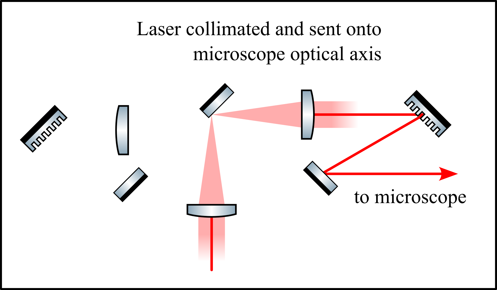

# Stage 1 cutoff edge: why and how to measure it

A bench procedure with its reasoning, for the first measurement towards calibrating the tunable
filter gratings (issue #29). The commands it uses are documented in their docstrings
(`help runfile`, `python tools/make_stage1_edge_runfiles.py --help`, and
`docs/command_reference.md`).

## 1. Why not jogging for intensity

The tunable filter is a double subtractive monochromator: there are two stages, each is a pair 
of gratings. The design is symmetric - a change at one end is designed to be undone by the other end.
Changing the angle of `g1` changes which wavelengths focus on which part of the intermediate slit, effectively
making a cutoff wavelength defined by those which strike the edge of the slit. 

The exit grating then undoes the dispersion and sends a
collimated beam outwards. The key is that even if you change `g1` a set amount, you will then change `g2` an equal amount to restore the alignment direction. But this just optimises which chunk of the spectrum passes the slit, and there's a large range of spectrum that can pass at once. The design is inherently tolerant of angular misaligment. This means:

- **The maximum is a broad plateau.** Its peak is set by noise and does not repeat.
- **The motors are coupled.** The right g2 depends on g1, so tuning one motor requires tuning the other to find the local mimima, over and over, to find the largest local minima.
- **Intensity is only half the reference:** The entrance gratings set
  *where the cutoff is* (a wavelength). The exit gratings set *where the beam points* (an
  angle). Intensity in the spectrograph can help the last one, but it requires care to make sure that each component is correctly decoupled.

So we start by defining the correct references to measure:

- **Entrance gratings (g1, g3): the wavelength of the cutoff edge**, read off the CCD, whose
  wavelength axis is now calibrated. We're reading a *spectral shape* so the overall intensity is not an issue.
- **Exit gratings (g2, g4): beam position or intensity through a small aperture** at that stage's own exit port.
  Each stage is aligned to its own entrance and exit ports, and relay mirrors carry the axis
  between stages.

## 2. How stage 1 works, and why its edge is special

The stage 1 edge is the cleaved edge of the 45 degree mirror that brings the laser in. There is
no beamsplitter: the mirror edge sits at the stage's intermediate focus and does two jobs.

**Laser in.** The laser is focused onto the mirror edge and diverges from it to the collimating
lens. The lens collimates it onto g1, which sends it along the microscope's optical axis.



**Scattered light back.** Light scattered from the sample comes back along the same axis. g1
disperses it, and the collimating lens, now working as a focusing lens, spreads the wavelengths
across the plane of the mirror edge:
- Rayleigh and anti-Stokes light focuses onto the mirror and is reflected away.
- Stokes light focuses just past the edge and continues to the next lens and g2.

g2 undoes the dispersion and sends a filtered, collimated beam on to stage 2.


**Why the edge calibration is also the laser calibration.** The laser and the edge are at the
same point, and light retraces its path. So the g1 setting that puts wavelength X on the edge is
also the setting that sends a laser at X down the microscope axis. The edge calibration measured
here therefore doubles as the laser pointing calibration, and the pinhole check becomes a test
of it.

**Alignment mode (the 608 steps).** Step 3 of `docs/grating_alignment_quickstart.md` turns g1 by
about 608 steps. That stops the laser going forwards to the microscope and retroreflects it
almost exactly onto itself, so it lands just past the mirror edge. From there it follows the
path the Stokes light will take: through the next lens and g2, and on to stage 2. That makes
it a visible reference for aligning everything downstream. In reality, a small angle offset from
the laser going back to the mirror, and passing the mirror, is a real error. It is **wavelength X**,
passing in the direction of light that should have **wavelength X** + *small stokes shift*, and
will be diffracted in a slightly different direction at the `g2`. This requires a 
"moment of faith" at the end of alignment, to bring `g1` back a few steps, while watching almost no
signal, in the hopes that this correction brings the Raman into view. Best done with a sample that 
gives lots of signal like sulfur of WSe2...


*At 1200 grooves/mm, the 10.7 degree rotation (608 steps of about 17.6 mdeg) turns the beam
about 21 degrees, which matches the angle between the two paths.*

## 3. What is measured, and why each detail matters

A broadband (halogen) lamp at the sample position fills the spectrum, and the edge shows on the
CCD as a step in that spectrum. Each frame gives:

- **Edge position.** Fitted with an error function. The edge position against g1 steps is the g1
  calibration.
- **Edge width.** How sharp the cutoff is, in cm^-1, which is what the science needs. The
  collimating lens focuses different wavelengths at slightly different distances (chromatic
  focal shift), so the edge should be sharpest at one wavelength and broaden away from it. The
  measured width against wavelength gives the cost of the lens, and the case for replacing that
  section with curved mirrors. The dispersion is already visible in the CCD image of old data:


The details of the procedure follow from those two quantities:

| Detail | Why |
|---|---|
| Stage 2 edge removed | Only one edge in the light path, so the step on the CCD is unambiguously stage 1's. |
| TRIAX slit about 50 um, not wide | The slit has to resolve the edge width (50 um is about 0.3 nm). A narrow slit does not bias the edge: when the gratings cancel the dispersion, every wavelength reaches the slit at the same spot. A wide slit is only needed later, for the exit-grating scans, where the spot moves. |
| Small lamp source | Along the dispersion direction, a source point off-centre at the sample lands on the edge like a different wavelength, magnified by roughly f_lens / f_objective (a large factor). A lamp filling the field smears the edge: the position is still fine, but the width is only an upper bound. Step 3 measures the true width. |
| Dark and Ar-Hg frames | The dark frame is subtracted. The Ar lines' width is the spectrograph's own line shape, which is removed from the edge width. |
| Edge-free frames each side | g1 moved about 67 nm each way. One frame passes everything (open) and one blocks everything (closed). Dividing by the open frame removes the lamp spectrum and the camera response; the closed frame shows how much light leaks through the edge. |
| Every position approached from the same side | The motors have backlash. Approaching from one side makes positions repeatable; the single-step run measures the backlash directly. |
| Centre wavelength put mid-chip | `st` alone puts a wavelength near the end of the chip (pixel 100), and the edge would run off it. The run files aim the TRIAX so the centre lands mid-chip, with about +/-40 nm visible. |
| File name holds the position | Saved spectra do not record grating steps, so a name like `s1edge_t800_g1m020` (centre 800 nm, g1 at -20 steps) is the record. The run log also stores the motor positions before each frame. |

Useful numbers:

- g1 moves the edge about 0.45 nm per step, about 7 cm^-1 at 800 nm.
- g3 moves about 2.1 nm per step, about 33 cm^-1 at 800 nm.
- The fit finds the edge to a fraction of a step, but a cutoff can only be set to the nearest
  step.

## 4. What to run

`runfile` runs a text file of ordinary commands in order:

- It checks the whole file before anything moves.
- It waits for each motor to stop before the next line.
- It stops at the first error, and says which line.
- Ctrl+C stops it without closing the program.
- Every command and result goes to a log in `data/runfile_logs/`.

### Set-up

1. Pull the latest code, then write the run files:

   ```
   python tools/make_stage1_edge_runfiles.py --exposure 0.5
   ```

   This writes `data/runfiles/stage1_edge_walk.txt` and `stage1_single_steps.txt`.
   - Choose `--exposure` after step 6 below, and re-run the command if it changes.
   - `--centres 760 800 840 ...` sets the centre wavelengths, if the lamp or camera do not
     reach the full 720-960 nm.
2. Laser off or blocked.
3. Stage 2 edge (the one nearest the spectrograph) removed. Stage 1 mirror left in place.
4. Halogen lamp at the sample focus. Use two aperture cards along the cage rails on the microscope optical axis to restrict the light to a more collimated beam - this essentially filters out off-axis and non-collimated light to mimic a centered beam down the optical axis. Let the lamp warm up for 15 minutes.
5. TRIAX entrance slit about 50 um. Record the value with `ren`.
6. Set the exposure:
   - Put 800 nm mid-chip: `st` with the value on the first `st` line of
     `stage1_single_steps.txt` (768.0 with the current config), then `sg 800`.
   - Take a test frame: `acqtime 0.5`, `nframe 1`, `filename s1ref_test`, `acquire`.
   - Adjust until the brightest pixel is about 30-40k counts, below saturation.

### Step 0: reference frames (by hand, about 10 minutes)

All at the same exposure and slit width.

- **Dark:** block the lamp, then `filename s1ref_dark`, `acquire`.
- **Ar-Hg:** with the Ar-Hg lamp in place of the halogen, `filename s1ref_arhg`, `acquire`.
- **Check:** with the halogen back and `sg 800`, take a frame (`filename s1ref_g1p000`,
  `acquire`). Then `g1 10` and another (`filename s1ref_g1p010`, `acquire`).
  - The edge should move about 4.5 nm. Note which direction it moves.
  - If it moves much more or less, stop: the step plan needs rescaling.

### Step 1: the edge walk (run file, about 49 frames)

```
runfile data/runfiles/stage1_edge_walk.txt
```

At each centre wavelength, the file:
1. puts the TRIAX and all gratings there;
2. takes frames at g1 = -20, -10, 0, +10, +20 steps (about +/-9 nm), each approached from below;
3. takes one frame at +150 steps and one at -150 steps (edge-free).

**Check after the first centre:** the edge is visible and moves between frames. If the lamp is
too dim at the ends of the range, regenerate the files with fewer `--centres`.

### Step 2: single steps (run file, 46 frames)

```
runfile data/runfiles/stage1_single_steps.txt
```

g1 goes from -20 to +20 steps around 800 nm one step at a time, then back down five single
steps. This shows whether the steps are even, how precisely an edge can be located, and the
backlash (how many reverse steps pass before the edge starts to move back).

### Step 3: the edge at operating conditions (by hand, about 30 minutes)

This measures the edge width with the real source: the laser spot.

1. Put a target that fluoresces in the NIR at the sample. Set the laser to its lowest useful
   power.
2. For 3-4 laser wavelengths across the Tiger's range (e.g. `sl 760`, `sl 820`, `sl 880`,
   `sl 940`):
   - align g1 to the pinhole as usual (quickstart step 2);
   - put the laser wavelength near mid-chip (as in set-up step 6);
   - `allmotors`, then `filename s1laser_l760` (with the matching wavelength), then `acquire`.

**Camera safety:** with the stage 2 edge out, only the stage 1 mirror keeps the laser off the CCD.
Start with the shortest exposure and increase it gradually.

The `allmotors` values give g1's laser-pointing setting at each wavelength. Comparing them with
the step 1 edge calibration tests the retracing argument in section 2.

### Step 4 (optional): g2 through an aperture

Only if an iris fits at stage 1's exit port (towards stage 2):
- Open the TRIAX slit to about 1 mm.
- Step g2 through the iris one step at a time until the signal falls away on both sides, and
  save each frame.
- Narrow the slit again afterwards.

This is the first test of the exit-grating method.

## 5. Afterwards

Copy these off the lab PC for fitting: the folders `data/s1ref_*`, `data/s1edge_*`,
`data/s1step_*` and `data/s1laser_*`, and the newest files in `data/runfile_logs/`.

The analysis, written once the data exists:
- dark subtraction and division by the open frame;
- an error-function fit per frame, giving edge position and width;
- the edge width corrected for the Ar line width;
- edge position against g1 (the calibration), step uniformity and backlash;
- edge width against wavelength, compared with the lens's predicted chromatic focal shift.

If the method holds, it becomes an automated `filtercal` command (issue #29), and stage 2 and
the exit gratings follow the same pattern.
